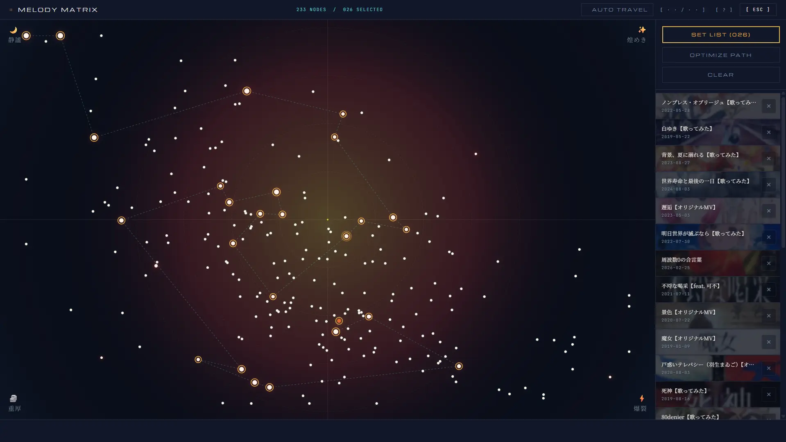

# kaf-song-analysis

[繁體中文](README.md) | **English**

You want a music visualizer to react to real songs from a YouTube channel without analysing audio in the browser. Give it a video URL, or let it walk a whole channel, and each song becomes one database row of per-song features plus two binary files of frame-by-frame spectrum data at 60 frames per second, all in your own Supabase project.

It was written for the KAF (花譜) catalogue and feeds [kaf-observatory](https://kaf-observatory.vercel.app). The audio analysis itself works for any artist; [the section below](#what-is-specific-to-kaf) lists what is tied to KAF.



*Above: kaf-observatory's Melody Matrix, drawn from the features this tool produces. Each dot is a song; the horizontal axis is `medianCentroidHz` (dark to bright timbre), the vertical axis is `meanSpectralContrastDb` (wall of sound to clearly separated instruments), and the corners are labelled 静謐 (calm), 煌めき (sparkle), 重厚 (heavy) and 爆裂 (explosive).*

```
$ node analyzer.mjs --url "https://www.youtube.com/watch?v=jpwy7kP8Pps" --dry-run
✓ video_id: jpwy7kP8Pps
✓ metadata: 【歌ってみた】猛独が襲う covered by 花譜 — KAF (259s, released 2018-10-31)
✓ analysis: 15509 frames, BPM 150 (conf 0.44)
✓ loudness range: LRA 3.2 LU
✓ clock_analysis: 15509 frames, 128 bins (fftSize 256)
✓ packed: analysis 1014.8 KB, clock 1.9 MB
✓ title: "【歌ってみた】猛独が襲う covered by 花譜" → "猛独が襲う【歌ってみた】"
✓ dry-run: row 505.0 B + blobs 2.9 MB = 2.9 MB (upload skipped)
```

- **Per-song features**: BPM with a confidence score, three spectral-centroid measures, EBU R128 loudness range, spectral contrast, and vocal-band onset rate and modulation, stored in a `metadata` JSON column.
- **Frame data**: an analysis file with 64 log-spaced bands, RMS loudness, centroid and a beat flag per frame, and a clock file with 128 FFT bins per frame that matches a Web Audio `AnalyserNode` with `fftSize` 256.
- **Whole channels**: `generate-urls.mjs` lists a channel's videos with yt-dlp, drops trailers, live versions and clips outside 125–600 seconds, and `batch.mjs` ingests the list overnight with pauses, one retry, and a file of failed URLs to rerun.
- **Safe reruns**: songs already in the table are skipped unless you pass `--force`, and `--dry-run` runs the full analysis without touching the database.

Input and output for one batch run:

```
# urls.txt: one URL per line, optional genre tag after a space
https://www.youtube.com/watch?v=jpwy7kP8Pps cover
https://youtu.be/abc12345678
```

```
kaf_songs row            video_id, title, artist, genre, release_date, metadata
analysis/<video_id>.bin  8-byte header + 67 bytes per frame
clock/<video_id>.bin     8-byte header + 128 bytes per frame
```

Videos longer than 12 minutes are rejected (`MAX_DURATION_SEC` in `analyzer.mjs`).

## What is specific to KAF

Downloading, spectrum analysis, binary packing and upload work for any artist, and `analyzer.mjs` accepts any YouTube URL. The places below are hard-coded around the KAF channel's conventions and need changes for another artist:

| Where | What is tied to KAF | For another artist |
|-------|---------------------|--------------------|
| `DEFAULT_CHANNEL`, `DEFAULT_OUT` in `generate-urls.mjs` | Scans the `@virtual_kaf` channel and writes `urls-virtual_kaf.txt` by default (`lint-titles.mjs` reads that file by default too) | Pass `--channel` and `--out`, or change the defaults |
| `shouldSkip` in `generate-urls.mjs` | Drops videos outside 125–600 seconds and titles containing `Trailer`, `Live Ver` or `前夜` | Adjust to the channel's naming |
| `KEEP_IDS`, `DROP_IDS` in `generate-urls.mjs` | Video IDs on the KAF channel that are always kept or always dropped | Empty them and add the new channel's exceptions |
| `classify` in `generate-urls.mjs` | Genre from title keywords: `歌ってみた`/`Cover`/`covered` → `cover`, `可不` → `kafu`, `組曲`/`Suite` → `suite`, everything else → `album` | Rewrite the rules, or skip genre tags |
| `src/title.mjs` | Cleans up KAF title formats, such as removing `covered by 花譜`, turning `花譜 #77「ソレカラ」` into the song name, and detecting `花譜×` collaborations | Rewrite the rules, and replace the cases in `src/title.test.mjs` |
| `TABLE` in `src/db.mjs`, `supabase-schema.sql` | The table is named `kaf_songs` (the `song-blobs` bucket has no artist in its name) | The name can stay; to rename it, change both files together |

The clock file's 128 bins per frame and `fftSize` 256 match the Web Audio setup in the kaf-observatory front end and have nothing to do with the artist. If your front end uses a different `fftSize`, change `src/clock_analysis.mjs`.

## How it works

```
YouTube ──► yt-dlp ──► ffmpeg (48 kHz PCM, loudness) ──► Meyda + FFT per frame
                                                              │
                                     your Supabase: table row + two .bin files in Storage
```

Audio streams through memory and is never saved to disk. There is no server; everything runs on your machine.

## Install

You need Node.js 20 or newer with pnpm, `yt-dlp` and `ffmpeg` on your `PATH`, and a Supabase project of your own.

1. Clone the repo and run `pnpm install`.
2. In Supabase, open **SQL Editor** and run `supabase-schema.sql`. It creates the `kaf_songs` table with public read access.
3. Open **Storage → New bucket**, turn **Public bucket** on, and use the bucket name given at the top of `supabase-schema.sql`. The analyzer writes to that fixed name.
4. Copy `.env.example` to `.env` and fill in your project URL and the **service-role** key from **Project Settings → API**. The analyzer writes past row-level security, so the public anon key will not work.
5. Try one song with `node analyzer.mjs --url "<youtube-url>" --dry-run`, then run it again without `--dry-run` to save it.
6. For a whole channel, run `node generate-urls.mjs --channel <channel-videos-url> --out urls.txt`, then `node batch.mjs urls.txt`.

`--dry-run` needs no `.env`, so step 5 works before Supabase is set up.

## Privacy & security

- The service-role key stays in your local `.env` and is only sent to your own Supabase project. It bypasses row-level security, so keep it off shared machines.
- The table and the bucket are public for reading: anyone with your project URL and anon key can read the features and frame files. Nobody can write without the service-role key.
- Only the title, uploader, release date and derived numbers are stored. No audio or video leaves your machine.
- yt-dlp talks to YouTube directly from your computer, under YouTube's terms.

## License

[MIT](LICENSE). Audio features are computed with [Meyda](https://meyda.js.org/).
